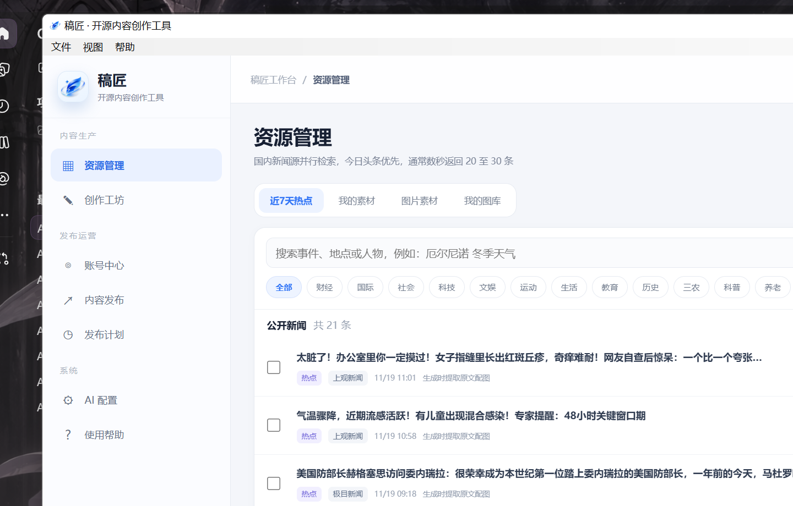
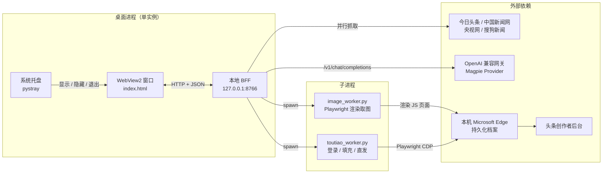

<div align="center">

# 稿匠 · GaoJiang

**面向今日头条图文创作的本机 AI 桌面工作台**

热点检索 → 素材核验 → AI 成稿 → 配图挑选 → 草稿归档 → 一键发布

全流程在本地闭环完成，账号凭据不出本机。

[功能特性](#功能特性) · [技术栈](#技术栈) · [系统架构](#系统架构) · [快速开始](#快速开始) · [HTTP API](#http-api) · [数据与隐私](#数据与隐私)

</div>



---

## 项目简介

稿匠是一个面向今日头条图文创作者的 Windows 桌面应用。它把「找选题、核事实、写正文、配图片、发文章」这条链路收敛到一个本地工作台里，所有新闻素材、成稿内容和浏览器登录态都只保存在本机。

与常见的「网页版 AI 写作工具」不同，稿匠不依赖云端账号体系，也不托管用户数据：

- **数据本地化**：新闻缓存、成稿、草稿、头条登录档案全部落在程序目录，服务只监听 `127.0.0.1`。
- **模型可插拔**：通过 OpenAI 兼容协议对接任意网关，默认读取本机 Codex 的 Magpie Provider 配置。
- **发布可回退**：既支持「打开头条并填充」交给人工确认，也支持后台直发；直发前有二次确认。
- **开箱即用**：发行版内置便携 Python 运行时，目标机器无需安装 Python，也无需管理员权限。

---

## 功能特性

| 模块 | 能力 |
| --- | --- |
| 资源管理 | 并行检索今日头条、中国新闻网、央视网、搜狗新闻；按关键词/分类过滤；支持近 7 天热点、素材库、图片素材、我的图库 |
| 素材核验 | 抓取原文正文与配图，展示来源、发布时间、分类；支持勾选后送入创作工坊 |
| 创作工坊 | 标题/分类/读者/篇幅/补充要求多字段编排；AI 联网补充素材；0–5 张正文配图；流式生成与随时中止 |
| 内容发布 | 标题规范化、重复标题剥离、内容声明、配图上传与封面生成；支持「填充待确认」与「直接发布」两种模式 |
| 账号中心 | 独立 Edge 持久化档案，扫码登录一次长期复用；全程不读取、不保存密码 |
| 发布计划 | 本地提醒队列，到点一键回到头条确认发布，保留人工把关环节 |
| AI 配置 | 自动发现本机 Magpie Provider 与可用模型；也支持手填 HTTPS 服务地址与临时 API Key（仅驻留内存） |

---

## 技术栈

| 层次 | 技术选型 | 说明 |
| --- | --- | --- |
| 桌面容器 | **pywebview 6** + WebView2（Edge Chromium） | 原生窗口 + 系统菜单 + 托盘，无需 Electron |
| 后端服务 | **Python 3.12** + `http.server.ThreadingHTTPServer` | 零 Web 框架依赖的本地 BFF，单进程内嵌 |
| 前端 | **原生 HTML / CSS / JavaScript**（单文件 `index.html`） | 无构建链、无 npm，直接由本地服务托管 |
| 网络抓取 | **urllib** + **BeautifulSoup4** + **lxml** | 多源搜索、正文抽取、相对链接归一化 |
| 浏览器自动化 | **Playwright 1.65** | 持久化上下文 + 系统 Edge，兼顾登录态与后台直发 |
| 图像处理 | **Pillow** | 托盘图标缩放、图片尺寸校验 |
| 系统集成 | **pystray** / **ctypes** / WScript.Shell | 托盘菜单、窗口激活、快捷方式创建 |
| 并发模型 | `ThreadPoolExecutor` + `threading` | 多源并行检索、生成任务隔离与取消 |
| 运行时分发 | **python-build-standalone (CPython 3.12)** | 可重定位的便携运行时，免安装 Python |
| 安装器 | **PowerShell 5.1** + `robocopy` | 免管理员安装、注册表卸载项、数据备份 |

---

## 系统架构



### 进程与端口

- 主进程：`pythonw.exe app.py`，同时承担 HTTP 服务与桌面窗口。
- 服务地址：`http://127.0.0.1:8766`，仅绑定回环地址。
- 子进程：发布与取图各自独立，异常不会拖垮主窗口。
- 单实例保护：启动器先探测 `/api/health`，已在运行则直接唤回窗口；若端口被残留进程占用但找不到窗口，会自动结束残留并重启。

### 桌面壳的双路径

1. **首选路径**：`pywebview` 创建原生 WinForms 窗口，内部承载 WebView2，提供原生菜单栏（文件 / 视图 / 帮助）与系统托盘。
2. **降级路径**：若 WebView2 不可用或 `pywebview` 初始化失败，自动改用 `msedge.exe --app=http://127.0.0.1:8766`，以独立应用窗口打开，功能不受影响。

---

## 关键设计

### 1. 零框架本地 BFF

后端直接基于标准库 `ThreadingHTTPServer` 实现路由与 JSON 响应，避免引入 Flask/FastAPI 带来的依赖体积与启动开销。所有业务状态以模块级字典与文件形式持有，配合 `DATA_ROOT` 常量实现「源码运行 / 冻结运行」两种路径解析。

### 2. 多源并行检索与相关性过滤

- 使用 `ThreadPoolExecutor` 同时请求多个来源，单源超时不影响整体返回。
- 结果经 `normalize_domestic_url` 归一化为标准域名，再用白名单站点表过滤非权威来源。
- `news_query_score` / `topic_candidate_matches` / `category_candidate_matches` 组合打分，剔除百科、词典、招聘、公关稿与时效过旧内容。
- 只读取候选前若干条的正文，配图在真正生成时才提取，显著降低检索延迟。

### 3. 可中断的流式生成

- 生成请求以 `request_id` 注册到 `ACTIVE_GENERATIONS`，保存取消事件与上游 socket。
- 前端点击「停止生成」触发 `/api/generate/cancel`，服务端立即 `shutdown` 上游连接并丢弃迟到结果，避免脏数据写入成稿。
- 采用 `select` 轮询上游分块，兼顾流式体验与取消响应。

### 4. 浏览器自动化的两种姿态

- **登录 / 填充**：`launch_persistent_context` 复用固定 `user_data_dir`，以有头模式打开，用户可扫码登录；填充完成后停在检查页。
- **直接发布**：同档案以 `headless=True` 启动，先校验登录态与 `media_id`，再上传图片、生成封面、提交正文与内容声明，最终以文章 ID 作为成功判据。
- 发布前会清理上一次残留的 Playwright 实例，避免同一档案被两个进程抢占而留下空白页。

### 5. 配图质量闸门

- 仅接受 `https` 图片，最小尺寸 `480×240`。
- 通过 URL 与 class 正则排除 Logo、图标、头像、二维码、推荐位、广告位等噪声。
- 优先命中 `article-content` / `rich_media_content` 等正文容器；不足时宁可少配，也不用无关图凑数。

### 6. 发布前文本规范化

- 标题统一去除多余空白并截断到 30 字以内（头条硬限制）。
- `strip_duplicate_heading` 剥离正文中与标题重复的首行，避免编辑器出现双标题。
- 正文长度、图片数量（0–5）、内容声明均在下发前校验。

---

## 目录结构

```text
稿匠/
├─ app.py                 # 桌面入口：HTTP 服务 + pywebview 窗口 + 托盘
├─ server.py              # 本地 BFF：检索、生成、草稿、发布编排
├─ toutiao_worker.py      # 头条自动化：登录 / 填充 / 直发
├─ image_worker.py        # 渲染型页面取图（Playwright）
├─ index.html             # 单文件前端（资源管理 / 创作工坊 / 发布 …）
├─ requirements.txt       # 运行依赖
├─ 启动稿匠.vbs / .bat    # 启动入口
├─ stop.ps1 / 停止稿匠.bat# 精确停止进程
├─ install.ps1            # 安装 / 卸载逻辑（面向发行版）
├─ 使用说明.md            # 面向使用者的操作手册
├─ icon.ico / icon.png    # 应用与托盘图标
└─ docs/
   └─ screenshot.png      # 界面截图
```

运行期生成、且**不会**进入版本库的目录：

```text
.toutiao-profile/   # 头条登录态（隐私数据）
发布草稿/           # 每篇文章一个时间戳目录（article.json + 图片）
历史版本/           # 本地历史快照
*.log               # 运行日志
```

---

## 快速开始

### 环境要求

- Windows 10 / 11（64 位）
- Python 3.11+（源码运行）
- Microsoft Edge（Win10/11 自带）
- 可选：WebView2 Runtime（缺失时自动降级为 Edge App 窗口）

### 源码运行

```powershell
git clone https://github.com/<your-name>/gaojiang-workbench.git
cd gaojiang-workbench

python -m pip install -r requirements.txt
python app.py
```

启动后访问 `http://127.0.0.1:8766`，或直接使用弹出的桌面窗口。

### 发行版安装

发行包为绿色压缩包，解压后双击 `安装稿匠.bat`：

1. 复制程序到 `%LOCALAPPDATA%\Programs\稿匠`（无需管理员权限）。
2. 创建桌面与开始菜单快捷方式。
3. 写入 `HKCU` 卸载项，可在「设置 → 应用」中卸载。
4. 卸载时可选保留 `发布草稿` 与 `.toutiao-profile`，自动备份到桌面。

发行包内置 python-build-standalone 运行时与全部依赖，目标机器无需联网下载组件。

---

## 配置模型服务

稿匠默认从当前用户的 Codex 配置读取 Magpie Provider：

```toml
# %USERPROFILE%\.codex\config.toml
[model_providers.magpie]
base_url = "http://127.0.0.1:3425/v1"
experimental_bearer_token = "your-token"
http_headers = { "X-Client" = "gaojiang" }
```

在「AI 配置」页点击「读取 Magpie 模型」即可获取可用模型列表（密钥不会回显到页面）。

也支持自定义 HTTPS 网关：填写 `baseUrl` 与 `model` 即可，接口需兼容 `POST /v1/chat/completions`。本机 `localhost` 允许使用 HTTP，其余地址强制 HTTPS。

---

## HTTP API

所有接口只监听 `127.0.0.1:8766`，返回 `application/json`。

| 方法 | 路径 | 用途 |
| --- | --- | --- |
| GET | `/api/health` | 健康检查，供启动器判断单实例 |
| GET | `/api/news?q=` | 关键词检索公开新闻 |
| POST | `/api/news` | 带模型配置的检索与相关性重排 |
| POST | `/api/enrich` | AI 联网补充素材（先规划检索词再抓取） |
| POST | `/api/generate` | 流式生成正文 |
| POST | `/api/generate/cancel` | 中止当前生成并关闭上游连接 |
| GET | `/api/magpie` | 读取本机 Magpie 地址与模型列表 |
| GET | `/api/publish/status` | 发布任务状态机 |
| GET | `/api/publish/drafts` | 列出本地发布草稿 |
| POST | `/api/publish/save` | 落盘草稿并做规范化校验 |
| POST | `/api/publish/open` | 打开头条并填充待确认 |
| POST | `/api/publish/login` | 打开独立登录窗口 |
| POST | `/api/publish/publish` | 后台直接发布 |

---

## 数据与隐私

- **不出网的数据**：成稿、草稿、素材勾选、发布计划、检索缓存、头条登录档案，全部留在本机。
- **会出网的数据**：你在「AI 配置」选定的模型请求（提示词与素材摘要），目标地址由你自己填写。
- **密码**：稿匠不读取、不保存、不显示头条密码；登录在独立 Edge 档案中完成，服务端只复用 Cookie 会话。
- **仓库卫生**：`.gitignore` 已排除 `.toutiao-profile/`、`发布草稿/`、`历史版本/`、全部日志与构建产物，避免误传隐私数据。
- **配图版权**：抓取的图片仅作为创作参考，发布前请自行核对版权与许可。

---

## 已知限制

- 仅支持 Windows，依赖 Edge 与 WebView2。
- 头条后台 DOM 结构变化时，`toutiao_worker.py` 的选择器需要同步适配。
- AI 能力依赖外部 OpenAI 兼容网关；网关不可用时，手动写作与发布链路仍可正常使用。
- 「发布计划」为本地提醒队列，不包含云端定时任务；发布动作仍由人工确认。
- 单实例基于 `8766` 端口，多开需求需自行修改端口。

---

## Roadmap

- [ ] 头条以外的分发渠道适配（百家号 / 网易号）
- [ ] 生成过程增量落盘，支持断点续写
- [ ] 素材去重与相似度聚类
- [ ] 可配置的站点白名单与信源权重
- [ ] 单文件可执行打包（PyInstaller / Nuitka 评估中）

---

## 免责声明

本项目仅用于个人内容创作效率提升。使用者需自行确保所发布内容真实、合法，并遵守今日头条平台规则与相关法律法规；因使用本工具产生的版权、合规与账号风险由使用者自行承担。
